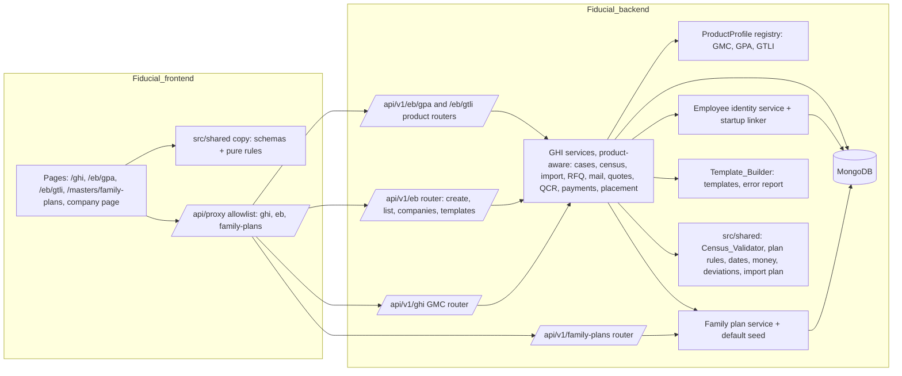
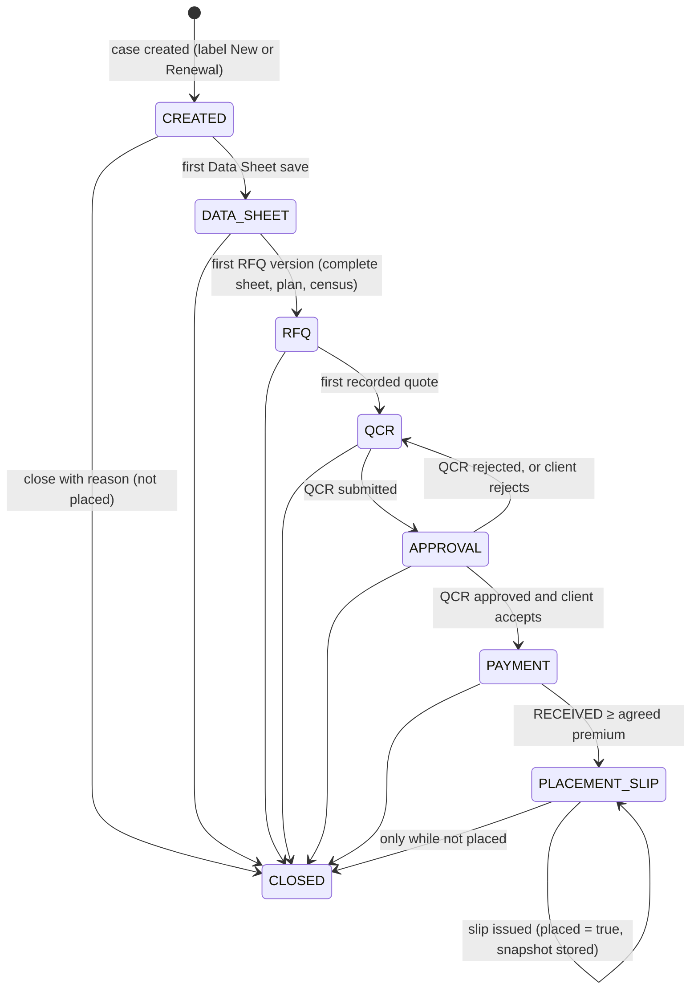
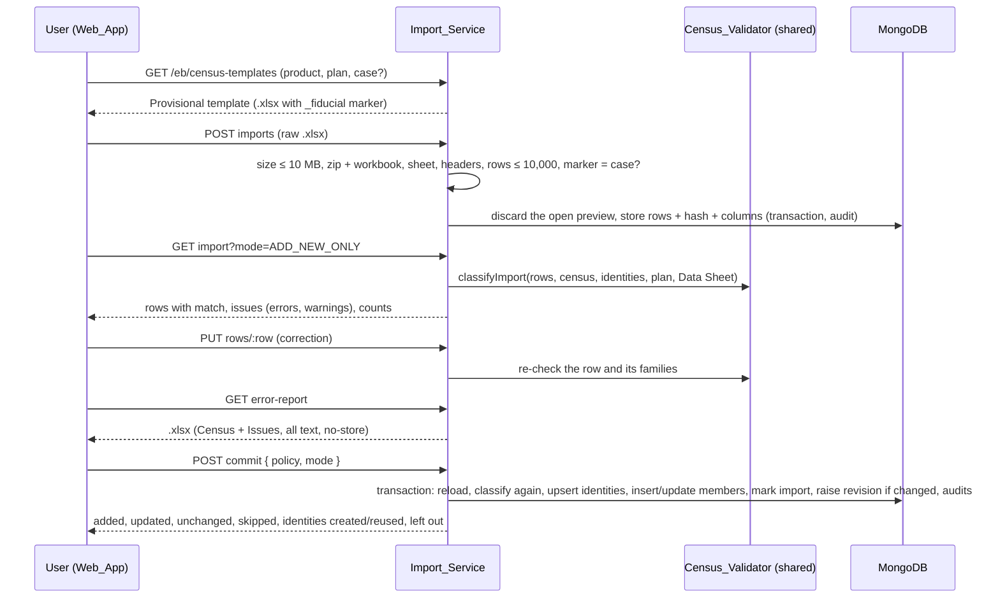

# Design Document

Employee Benefits (GPA and GTLI), Family Plan Master and product census templates.

## Overview

This design adds GPA and GTLI beside GMC by making the existing GHI module product-aware rather than copying it. A
GPA or GTLI case is a document in `ghi_cases` with a `product` field. It reuses the GHI census, RFQ, mail, quote,
QCR, file and payment collections and services, and gets its own Data Sheet, quote terms, stages, client decision
and placement through a **product profile**. GMC keeps every `/api/v1/ghi` route. Changes there are additive only,
and stored documents are only ever extended with new fields.

Three new pieces sit beside the module:

- **Family Plan Master** (`src/modules/family-plans/`, collection `family_plans`): versioned plans per product,
  seeded with seven default plans at startup and assigned to companies (`eb_client_plan_defaults`) and cases (a
  copy of the slots on the case).
- **Employee identity** (`src/modules/employees/`, collection `eb_employees`): one record per company and employee
  key. Every Self member references one, and existing GHI members are linked at startup without rewriting them.
- **Census pipeline** (Template_Builder, Import_Service, Census_Validator): the seven provisional templates, upload
  with a row-level preview, corrections, an Excel error report, and import by policy and mode with exact counts in
  one transaction.

The pure rules (plan configuration, Census_Validator, date parsing, salary-multiple sum insured, quote GST, GPA/GTLI
deviations, import classification) live in `src/shared`. The API and the Web_App run the same code, and the
frontend's fast-check property tests exercise it (the backend has no fast-check, and no dependency is added).

### What the existing code does (findings that shape the design)

| Area              | Finding                                                                                                                                                                                                                                                                                  | Consequence                                                                                                                                                                             |
| ----------------- | ---------------------------------------------------------------------------------------------------------------------------------------------------------------------------------------------------------------------------------------------------------------------------------------- | --------------------------------------------------------------------------------------------------------------------------------------------------------------------------------------- |
| Case model        | `ghi_cases.requirements` is `Mixed`, validated by `GhiRequirementsInputSchema` before every write. Stages are one enum `GHI_STAGES`; `advanceStage()` moves forward by index; `returnToStage()` moves back from listed stages.                                                           | GPA/GTLI Data Sheets fit the same field, validated by their own schema. Their stages are an ordered subset of `GHI_STAGES`, so `advanceStage()` works as is.                            |
| Case loading      | `loadCase(id)` reads by `_id` only, and every GHI service calls it.                                                                                                                                                                                                                      | `loadCase` gets a product scope, so `/ghi` answers 404 for a GPA case and the reverse (Requirement 2.9).                                                                                |
| Census rules      | `modules/ghi/census-rules.ts` is pure and imports only `src/shared`, but it lives in the backend. Family checks read `familyDefinition`: one spouse, at most `min(maxChildren, 3)` children, parents or in-laws never mixed.                                                             | It moves to `src/shared/census-rules.ts` verbatim, and the backend file becomes a re-export, so `census-rules.test.ts` keeps passing unchanged. Plan mode is new code beside it.        |
| Import guard      | `ghi_census_imports` has a partial unique index `{caseId, sha256}` on `status: 'IMPORTED'`, where `sha256` is a fingerprint of the parsed rows.                                                                                                                                          | GMC keeps it (22.8). GPA/GTLI must allow the same file twice (22.5), so their imports go to a twin collection `eb_census_imports` without that index. Indexes are never dropped (25.5). |
| Quote calc        | `premiumOf()` uses `Decimal` with ROUND_HALF_UP. `compareTerms()` decides whether the parents' co-payment is asked from `requested.familyDefinition.parents !== 'NONE'`. The same test appears in `missingRequirements()`, the Data Sheet schema's `superRefine` and `ghi-documents.ts`. | See decision D6 (the GMC gap from review).                                                                                                                                              |
| Shared arithmetic | `src/shared/quotes.ts` does money in `BigInt` paise because the frontend has no decimal.js.                                                                                                                                                                                              | Shared pure money functions use BigInt fixed point. The API keeps `Decimal` for stored amounts (25.7), and both are pinned by an equivalence test (D9).                                 |
| Claims            | `placedPolicy()` and `claimPolicies()` find placed GMC policies by `policy != null`, and members by `caseId` and `employeeKey`.                                                                                                                                                          | GPA/GTLI placement uses a separate `placement` field (with `policy` staying null), so claims never see them. A defensive GMC product filter is added (16.9).                            |
| Members           | `ghi_members` has `timestamps: true` and a unique `{caseId, employeeKey}` index on Self rows. It holds no `clientId`.                                                                                                                                                                    | Startup linking updates with `{ timestamps: false }`, so `updatedAt` does not change (16.1). Company-wide lookups join through `ghi_cases.clientId`.                                    |
| Audit             | GHI action labels say "Group health …". `writeAudit()` accepts `userId: null`.                                                                                                                                                                                                           | GPA/GTLI get `EB_*` actions on a new `eb_case` entity. The startup seed and linker write system entries (`userId: null`).                                                               |
| Startup           | `server.ts` runs `ensureIndexes()` (every model in `models.ts`), then `ensureEmailTemplates()` and `ensureClaimEmailTemplates()`.                                                                                                                                                        | `ensureDefaultFamilyPlans()` and `linkEmployeeIdentities()` are added in the same place.                                                                                                |
| Frontend          | The proxy allowlist has `ghi` and `claims`. `components/ghi/` has the workspace, census and import panels (several files above 250 lines). The nav item is "Group Health"; `line-of-business.tsx` offers Property or Group Health.                                                       | New areas `eb` and `family-plans`. New components go in `components/eb/` and `components/family-plans/`; the GHI panels take a `product` prop instead of being copied.                  |

External behaviour relied on:

- exceljs writes a cell as a formula only when the value is a `{ formula }` object; a string starting with `=` is
  written as a string, and setting `numFmt = '@'` keeps it as text when edited. exceljs supports a worksheet state of
  `veryHidden` ([exceljs README, worksheet state](https://github.com/exceljs/exceljs#worksheet-state)), and Excel
  keeps such sheets when saving.
- MongoDB retries an upsert that fails with a duplicate key error when the query is an equality match on the unique
  index's fields ([MongoDB manual, upsert with a unique index](https://www.mongodb.com/docs/manual/reference/method/db.collection.updateone/#upsert-with-unique-index)).
  Concurrent identity and default-plan creation relies on this, inside transactions that are retried on write
  conflicts.

### Design decisions

| #   | Decision                                                                                                                                                                                                                                                                                                                                                                                                                                                                                                                                                                                                                                                                                                                                                                                                                                                                                                                                                                                                                                                                       | Requirements              |
| --- | ------------------------------------------------------------------------------------------------------------------------------------------------------------------------------------------------------------------------------------------------------------------------------------------------------------------------------------------------------------------------------------------------------------------------------------------------------------------------------------------------------------------------------------------------------------------------------------------------------------------------------------------------------------------------------------------------------------------------------------------------------------------------------------------------------------------------------------------------------------------------------------------------------------------------------------------------------------------------------------------------------------------------------------------------------------------------------ | ------------------------- |
| D1  | One case collection (`ghi_cases`) for all products, with an optional `product` field. A missing field reads as GMC, and the GMC filter is `{ product: { $in: [null, 'GMC'] } }` (null matches a missing field). New GMC cases store `product: 'GMC'`; old ones are never written to.                                                                                                                                                                                                                                                                                                                                                                                                                                                                                                                                                                                                                                                                                                                                                                                           | 1.5, 1.7, 16.2, 25.6      |
| D2  | GMC stays on `/api/v1/ghi`. GPA and GTLI each get a router built by one factory and mounted at `/api/v1/eb/gpa` and `/api/v1/eb/gtli`. Cross-product endpoints (create, list, companies, templates) are under `/api/v1/eb`. A route only loads cases of its own product.                                                                                                                                                                                                                                                                                                                                                                                                                                                                                                                                                                                                                                                                                                                                                                                                       | 2.2, 2.3, 2.9, 16.6       |
| D3  | A `ProductProfile` per product (`gmc.ts`, `gpa.ts`, `gtli.ts`) supplies: the Data Sheet schema and missing items, census settings, template columns, quote terms schema and deviations, QCR rows, document models, the agreed premium, the stage after the client's acceptance, and next-step texts. The GHI services take a `CaseScope` (`{ product, profile }`); `/ghi` passes the GMC scope.                                                                                                                                                                                                                                                                                                                                                                                                                                                                                                                                                                                                                                                                                | 3.7, 16.6                 |
| D4  | GPA/GTLI imports use `eb_census_imports`, a twin of `ghi_census_imports` (same schema) without the unique fingerprint index, because they must accept the same file twice and report it as unchanged. GMC keeps its collection, its index and its guard.                                                                                                                                                                                                                                                                                                                                                                                                                                                                                                                                                                                                                                                                                                                                                                                                                       | 22.5, 22.8, 25.5          |
| D5  | `census-rules.ts` moves to `src/shared` verbatim (the backend path re-exports it). The Census_Validator dispatches to it unchanged for a GMC case without a plan (**legacy mode**), and to new slot-based family checks in **plan mode**.                                                                                                                                                                                                                                                                                                                                                                                                                                                                                                                                                                                                                                                                                                                                                                                                                                      | 16.3, 16.4, 18.1, 18.11   |
| D6  | **GMC with a plan: who counts as "parents covered".** Wherever GMC asks "does the cover include parents?" (the co-payment row in `compareTerms()`, the co-payment item in `missingRequirements()`, the Data Sheet's co-payment check, and the family and co-payment lines in `ghi-documents.ts`), one helper `gmcFamilyCover(doc)` answers it. With no plan it uses `familyDefinition.parents !== 'NONE'`, exactly as today. With a plan it uses "a slot of the assigned plan accepts Father, Mother, Father-in-law or Mother-in-law". This invents no rule: it is today's question answered from the source that Requirement 16.4 makes authoritative. The co-payment check therefore moves from the schema's `superRefine` into the service (same path, message and 400). Today a co-payment applies to parents and to parents-in-law alike; with a plan that stays the same. **Flagged:** whether the client wants different co-payments for parents and parents-in-law is not asked and stays out of scope (listed in OPEN_ITEMS as a GMC design note, not a client rule). | 16.4, 16.7, 7.4           |
| D7  | **Identity checks on GMC.** Requirements 17.2 to 17.5 and 17.12 apply to every product, so a GMC Self row whose name, gender or date of birth differs from the company's identity for that employee key is refused. This is the one way a GMC row accepted today can be refused (Requirement 16.3 says otherwise). **Flagged for confirmation**, with the alternative of skipping identity checks on GMC cases that have no plan (their Self members would then link only when they agree). Any existing GHI integration test this affects is named in its task (26.7).                                                                                                                                                                                                                                                                                                                                                                                                                                                                                                        | 16.3, 17.2–17.5, 26.7     |
| D8  | **GMC legacy commit.** A GMC commit that names no `mode` keeps today's behaviour: a row equal to a census member is a duplicate error (16.7). A GMC commit that names a mode, and every GPA/GTLI commit, follows Requirement 22.2 (where no mode means Add new only). **Flagged** as the reading of 16.7 against 22.2.                                                                                                                                                                                                                                                                                                                                                                                                                                                                                                                                                                                                                                                                                                                                                         | 16.7, 22.2                |
| D9  | Money: the API stores and computes with `Decimal` (25.7). It uses `premiumOf()` for quotes and `eb-calc.ts` for the salary multiple and percentage. `src/shared/eb-money.ts` holds exact BigInt twins for the Web_App's typing feedback and the property tests. A backend unit test runs both over the same grid and asserts they agree. The Census_Validator does not compute sums insured itself: it takes a `deriveSumInsured` function, which the API supplies from Decimal and the Web_App from BigInt.                                                                                                                                                                                                                                                                                                                                                                                                                                                                                                                                                                   | 4.3, 5.4, 7.2, 25.7, 26.5 |
| D10 | **Client decision replaced at Payment.** Requirement 9.8 allows a new decision while no payment is RECEIVED, and Requirement 3.4 allows only Approval → QCR backwards. So at Payment a replacement may only be an acceptance (another insurer, or the same one again); a rejection at Payment is refused (409) and the user can close the case instead. **Flagged** for confirmation.                                                                                                                                                                                                                                                                                                                                                                                                                                                                                                                                                                                                                                                                                          | 3.4, 9.7, 9.8             |
| D11 | Plan assignment changes raise `requirementsRevision`, not `censusRevision`, so the RFQ fingerprint (`requirementsRevision:censusRevision`) goes out of date (6.4) while an unchanged re-import still leaves `censusRevision` alone (22.5).                                                                                                                                                                                                                                                                                                                                                                                                                                                                                                                                                                                                                                                                                                                                                                                                                                     | 6.4, 22.5                 |
| D12 | "Unresolved employee" is derived, not stored: a Self member with no `employeeIdentityId` after startup linking (new Self members always get one at write). The company employee list computes it on read.                                                                                                                                                                                                                                                                                                                                                                                                                                                                                                                                                                                                                                                                                                                                                                                                                                                                      | 17.10–17.13               |
| D13 | Plan metadata is written to a `veryHidden` sheet `_fiducial` (key/value rows), outside both visible sheets. Typing, sorting and row edits on Census never touch it.                                                                                                                                                                                                                                                                                                                                                                                                                                                                                                                                                                                                                                                                                                                                                                                                                                                                                                            | 19.7, 20.4, 20.13         |
| D14 | A policy snapshot is a header document (`eb_policy_snapshots`) plus one document per member (`eb_policy_snapshot_members`), so a large census never approaches the 16 MB document limit. Neither is ever updated (append-only hooks, as `ghi_dispatches` does).                                                                                                                                                                                                                                                                                                                                                                                                                                                                                                                                                                                                                                                                                                                                                                                                                | 11.2, 11.4                |
| D15 | Template columns have three requirement levels: `ALWAYS` (cell filled on every row), `EMPLOYEE_ROW` (filled on Self rows) and `NO`. A column of either required level must be present in the file (20.3). Instructions show them as "Yes", "Yes, on the employee's row" and "No". This keeps Requirement 18.3 ("required columns are filled") true for a GPA 1+3 salary census, whose dependants have no salary.                                                                                                                                                                                                                                                                                                                                                                                                                                                                                                                                                                                                                                                               | 18.3, 19.2, 19.4, 20.3    |

## Architecture



Every route runs `authenticate()`, then one `requirePermission()`, then `route()` with strict Zod schemas, then the
service. Every write runs in `withTransaction()` with its `writeAudit()` or `writeAudits()` in the same session.

### Product scope

```ts
// src/modules/ghi/products/profile.ts
export type EbProduct = 'GMC' | 'GPA' | 'GTLI';
export interface CaseScope {
  product: EbProduct;
  profile: ProductProfile;
}
export function productFilter(product: EbProduct) {
  return product === 'GMC' ? { product: { $in: [null, 'GMC'] } } : { product };
}
// loadCase(id, session?, scope = GMC_SCOPE): findOne({ _id, ...productFilter(scope.product) }) or 404
```

`ProductProfile` (one object per product, pure where it can be):

| Member                                    | GMC                                                  | GPA                                                   | GTLI                                       |
| ----------------------------------------- | ---------------------------------------------------- | ----------------------------------------------------- | ------------------------------------------ |
| `requirementsSchema`, `emptyRequirements` | `GhiRequirementsInputSchema` (unchanged)             | `GpaRequirementsInputSchema`                          | `GtliRequirementsInputSchema`              |
| `missingRequirements(doc)`                | today's list, with the co-payment item via D6        | Requirement 4.7                                       | Requirement 5.6                            |
| `censusContext(doc, …)`                   | legacy mode without a plan, plan mode with one       | plan mode (no plan: census writes refused, 18.10)     | plan mode (as GPA)                         |
| `stages`                                  | `GHI_STAGES`                                         | `EB_STAGES`                                           | `EB_STAGES`                                |
| `afterAcceptance`                         | `FINAL_QCR`                                          | `PAYMENT`                                             | `PAYMENT`                                  |
| `agreedPremium(doc)`                      | the final QCR quote total (today)                    | the accepted client decision's `agreedPremium`        | as GPA                                     |
| `quoteTermsSchema`, `deviations()`        | `GhiQuoteTermsInputSchema`, `deviationsOf()` with D6 | `GpaQuoteTermsSchema`, `gpaDeviations()`              | `GtliQuoteTermsSchema`, `gtliDeviations()` |
| `documents`                               | `ghi-documents.ts`                                   | `eb-documents.ts` (built-in RFQ, QCR, placement slip) | as GPA                                     |
| `templateColumns(plan, requirements)`     | 7 GMC columns (Relationship from the slots)          | GPA columns, salary/SI by basis (19.2)                | GTLI columns                               |
| `auditEntity`, `actions`                  | `ghi_case`, `GHI_*`                                  | `eb_case`, `EB_*`                                     | `eb_case`, `EB_*`                          |

### Module layout

Fiducial_backend:

```
src/shared/
  census-rules.ts         moved verbatim from modules/ghi (legacy GMC rules, dates, rupees, aliases, ageOn)
  eb.ts                   EB_PRODUCTS, EB_STAGES, labels, create/list/record/edit/close schemas, prefixes
  eb-requirements.ts      GPA and GTLI Data Sheets: sum insured basis, covers, dependant basis, missing items
  family-plans.ts         plan, version and slot schemas (rules 13.2–13.7), DEFAULT_FAMILY_PLANS, versionOn(), overlaps()
  eb-census.ts            EB census columns, row values, member input (+ annualSalary), issue schema, template
                          column sets, header aliases and resolveHeaders()
  eb-census-rules.ts      Census_Validator: checkEbCensus(), familyShortfalls(), identityMismatches(), freeCoverFlags()
  eb-import-plan.ts       classifyImport(), applyImportPlan(): pure import plan and its counts
  eb-money.ts             BigInt twins: salaryMultipleSumInsured(), percentOfSumInsured(), ebPremium()
  eb-quotes.ts            GPA/GTLI quote terms, gpaDeviations(), gtliDeviations()
  eb-workflow.ts          EB QCR save/decision with fingerprint, client decision, payments summary, placement
  eb-employees.ts         employee identity, list query, update and resolve requests
  ghi.ts, ghi-census.ts, ghi-workflow.ts   additive fields only (product, plan, mode, fileWarnings, severity)
src/modules/ghi/
  products/profile.ts, gmc.ts, gpa.ts, gtli.ts   ProductProfile registry
  census-rules.ts         re-export of src/shared/census-rules.ts (keeps census-rules.test.ts as is)
  eb-calc.ts              Decimal: salary multiple, percentage of sum insured (the API's amounts)
  eb-cases.service.ts     create with product and references, cross-product list, plan at creation
  eb-plan-assignment.service.ts   assign or change a case's plan (15.3–15.9)
  eb-census-template.ts   Template_Builder: provisional templates, metadata sheet, error report
  eb-census-import.service.ts     upload, preview by mode, correct, commit (identities, counts), error report
  eb-placement.service.ts GPA/GTLI client decision, payments' expected premium, placement issue and snapshot
  eb-documents.ts         GPA/GTLI RFQ, QCR and placement slip models (written through ghi-sheet.ts)
  eb-placement.model.ts   eb_policy_snapshots, eb_policy_snapshot_members
  eb.routes.ts            /api/v1/eb: cases, companies' employees and plan defaults, census templates
  eb-product.routes.ts    createEbProductRouter(scope), mounted at /eb/gpa and /eb/gtli
  (existing services take a CaseScope; census.service.ts keeps the GMC legacy import path)
src/modules/family-plans/
  family-plan.model.ts, family-plans.service.ts, family-plans.routes.ts, default-plans.ts, client-plan-default.model.ts
src/modules/employees/
  employee.model.ts (eb_employees), employees.service.ts, employee-link.ts (startup linker)
```

Fiducial_frontend:

```
src/app/(app)/eb/[product]/page.tsx + eb-list-view.tsx        GPA/GTLI case list (product: gpa | gtli)
src/app/(app)/eb/[product]/[id]/page.tsx + eb-case-view.tsx   GPA/GTLI case workspace
src/app/(app)/masters/family-plans/page.tsx + family-plans-view.tsx, [id]/page.tsx + family-plan-view.tsx
src/components/eb/          product-choice, new-eb-case-form, eb-workspace, eb-tabs, gpa-requirements-form,
                            gtli-requirements-form, sum-insured-basis-fields, gpa-covers-fields, plan-card,
                            assign-plan-dialog, template-download-dialog, import-mode-fields, error-report-button,
                            eb-quote-form, gpa-terms-fields, gtli-terms-fields, eb-qcr-panel, client-decision-panel,
                            eb-placement-panel, awaiting-confirmation-badge, provisional-notice
src/components/family-plans/  plan-table, plan-form-sheet, version-editor, slot-fieldset, version-card,
                            version-actions (activate, end, confirm), deactivate-dialog
src/components/clients/     employees-card, employee-dialog (update / resolve), plan-defaults-card
src/components/ghi/         census-panel, census-import, member-dialog, rfq-panel, qcr-table, payments-panel take a
                            `product` prop (and are split below about 250 lines where touched)
src/lib/eb/                 query keys and fetchers; *.property.test.ts (fast-check) for the shared pure modules
```

## Components and Interfaces

### Shared contracts (`src/shared`)

`eb.ts`

```ts
export const EB_PRODUCTS = ['GMC', 'GPA', 'GTLI'] as const;
export const EB_PRODUCT_LABELS = {
  GMC: 'GMC (Group Health)',
  GPA: 'GPA (Group Personal Accident)',
  GTLI: 'GTLI (Group Term Life Insurance)',
};
export const EB_REFERENCE_PREFIX = { GMC: 'GHI', GPA: 'GPA', GTLI: 'GTLI' };
export const EB_STAGES = [
  'CREATED',
  'DATA_SHEET',
  'RFQ',
  'QCR',
  'APPROVAL',
  'PAYMENT',
  'PLACEMENT_SLIP',
  'CLOSED',
] as const;
export const CreateEbCaseRequestSchema; // { product, ...CreateGhiCaseRequestSchema fields }: strict, same refinements
export const EbCaseListQuerySchema; // { product?, stage? (GHI_STAGES), type?, clientId?, q? (trim, 1–100, blank = none),
//   page 1–10,000 (default 1), limit 1–100 (default 20) }
export const EbCaseListItemSchema; // GhiCaseListItemSchema + product
export const EbCaseCreatedSchema; // { id, product, reference }
export const UpdateEbCaseRequestSchema; // = UpdateGhiCaseRequestSchema (strict: names product/type/client → 400)
export const EbPlanAssignmentSchema; // { planId, code, name, product, version, slots, parentsAndInLawsMixed,
//   clientConfirmed (live), openQuestions, source, assignedAt, assignedBy }
export const EbCaseRecordSchema; // GhiCaseRecordSchema minus requirements/finalQcr/policy, plus product
// ('GPA'|'GTLI'), requirements (GPA or GTLI by product), plan, placement
```

Additive fields on GMC contracts: `GhiCaseRecordSchema` gets `product: 'GMC'` and `plan: EbPlanAssignmentSchema.nullable()`.
`GhiCaseListItemSchema` gets `product`. `GhiCensusImportSchema` gets `fileWarnings`, `mode` and `result`.
`GhiCensusIssueSchema` gets an optional `severity`. `CommitGhiImportRequestSchema` gets an optional `mode`.
`GhiCensusSummarySchema` gets optional `freeCoverLimit` and `aboveFreeCoverLimit` (GTLI only). Nothing is renamed or
removed (16.6).

`eb-requirements.ts`

```ts
export const SumInsuredBasisSchema = z.discriminatedUnion('kind', [
  z.strictObject({ kind: z.literal('FLAT'), amount: PositiveRupees }),
  z.strictObject({ kind: z.literal('GRADED'), amounts: z.array(PositiveRupees).min(1).max(10) /* each once */ }),
  z.strictObject({ kind: z.literal('SALARY_MULTIPLE'), multiplier: Multiplier /* >0, ≤100, ≤2 dp, string */,
                   maximum: PositiveRupees.nullable() }),
]).nullable();                                  // strictObject per variant: values of another basis → 400 (4.8)
export const GPA_COVERS = ['accidentalDeath','permanentTotal','permanentPartial','temporaryTotal'] as const;
export const CoverChoiceSchema = z.enum(['REQUIRED','NOT_REQUIRED']).nullable();
export const DependantBasisSchema = z.discriminatedUnion('kind', [
  z.strictObject({ kind: z.literal('EMPLOYEE_SUM_INSURED') }),
  z.strictObject({ kind: z.literal('OWN_AMOUNT') }),
  z.strictObject({ kind: z.literal('PERCENT_OF_EMPLOYEE'), percent: Percent2dp /* >0, ≤100 */ }),
]).nullable();
export const GpaRequirementsInputSchema = z.strictObject({
  company, employeeCount /* 1–1,000,000 or null */, sumInsuredBasis, covers: { …4 × CoverChoice },
  temporaryTotal: { weeklyBenefit: PositiveRupees.nullable(), weeks: int 1–520 nullable },
  otherCovers: text ≤1000, dependantBasis, ageLimits (4 groups, as GMC), ageReferenceDate,
  claims (≤3, GhiClaimYearInputSchema, each year once), otherRequirements: text ≤2000,
}).superRefine(/* TTD benefit/weeks only while TTD is REQUIRED (4.8); unique claim years */);
export const GtliRequirementsInputSchema = z.strictObject({
  company, employeeCount, sumInsuredBasis, freeCoverLimit: PositiveRupees.nullable(), ageLimits,
  ageReferenceDate, claims, additionalBenefits: text ≤2000, otherRequirements: text ≤2000,
});
export function gpaMissing(input, ctx: { saved: boolean; planHasDependants: boolean }): MissingItem[]   // 4.7
export function gtliMissing(input, ctx: { saved: boolean; renewal: boolean }): MissingItem[]           // 5.6
// MissingItem = { field: string; label: string }
```

Strict objects make a GMC field (such as `maternity`) or a field of the other product a 400 that names the field (4.11, 5.5).
Amounts are digit strings, and a JSON number is refused by the string schemas (25.7).

`family-plans.ts`

```ts
export const PlanSlotSchema = z.strictObject({
  name: z.string().trim().min(1).max(50),
  min: z.number().int().min(0).max(10), max: z.number().int().min(1).max(10),
  relationships: z.array(z.strictObject({ relationship: GhiRelationshipSchema, max: z.number().int() })).min(1),
});
export const PlanVersionInputSchema = z.strictObject({
  effectiveFrom: z.iso.date(), effectiveTo: z.iso.date().nullable(),
  parentsAndInLawsMixed: z.boolean(),           // required: no default (13.7)
  slots: z.array(PlanSlotSchema).min(1).max(7),
}).superRefine(planVersionIssues);              // 13.3–13.6 and effectiveTo ≥ effectiveFrom; every issue at once (13.9)
export function planVersionIssues(version, ctx): void   // path: ['slots', i, 'relationships', j, 'max'] etc.
export const CreateFamilyPlanRequestSchema = z.strictObject({ product, code: /^[A-Za-z0-9+-]{1,20}$/, name: 1–80,
  firstVersion: PlanVersionInputSchema });
export const DEFAULT_FAMILY_PLANS: readonly DefaultPlan[]    // the 7 plans of 14.2 with their open questions
export function versionOn(plan: PlanLike, date: string): PlanVersionLike | null   // Active, from ≤ date ≤ to
export function overlaps(a: DateRange, b: DateRange): boolean                       // shared day; null "to" = open
export function planAcceptsParents(slots): boolean      // used by gmcFamilyCover (D6)
```

The same schema is the Web_App form's resolver, so each error shows on its field before saving (13.10).

`eb-census.ts`

```ts
export const EB_CENSUS_FIELDS = [
  'employeeId',
  'name',
  'gender',
  'dateOfBirth',
  'relationship',
  'dateOfJoining',
  'sumInsured',
  'annualSalary',
] as const;
export type ColumnRequirement = 'ALWAYS' | 'EMPLOYEE_ROW' | 'NO';
export interface TemplateColumn {
  key: EbCensusField;
  header: string;
  required: ColumnRequirement;
  help: string;
}
export function templateColumns(
  product,
  slots,
  basis: SumInsuredBasis | 'UNKNOWN' | null,
): TemplateColumn[]; // 19.1, 19.2
export function relationshipValues(slots): GhiRelationship[]; // from the slots; [] when only Self
export const EB_HEADER_ALIASES: Record<EbCensusField, readonly string[]>; // GMC aliases + "Annual Salary", "CTC", "Salary"
export function resolveHeaders(headers: readonly string[]): {
  columns: Map<EbCensusField, number>;
  unknown: string[];
};
export const EbCensusRowValuesSchema; // 8 text fields, each ≤200
export const EbMemberInputSchema; // GhiMemberInputSchema + annualSalary (blankAsNull rupees)
export const EbCensusIssueSchema = z.object({
  row: z.number().int().nullable(),
  employeeId: z.string().nullable(),
  name: z.string().nullable(),
  relationship: GhiRelationshipSchema.nullable(),
  field: z.enum(EB_CENSUS_FIELDS).nullable(),
  value: z.string().nullable(),
  message: z.string(),
  fix: z.string(),
  severity: z.enum(['ERROR', 'WARNING']),
  code: z.string(),
});
export const EB_IMPORT_MODES = ['ADD_NEW_ONLY', 'ADD_AND_UPDATE'] as const;
export const EbImportRowSchema; // row, values, issues, valid, corrected, imported, match: NEW|SAME|CHANGED|null
export const EbImportResultSchema; // { added, updated, unchanged, skipped, identitiesCreated, identitiesReused,
//   leftOut: [{ row, employeeId, issues }] }
```

### Pure modules

**Census_Validator** (`eb-census-rules.ts`)

```ts
export interface EbCensusContext {
  product: EbProduct;
  family: { mode: 'LEGACY'; definition: GhiFamilyDefinition } | { mode: 'PLAN'; plan: PlanRules };
  members: GmcMemberRules | GpaMemberRules | GtliMemberRules; // coverage/options; basis + dependant basis; basis + FCL
  ageLimits: Record<GhiAgeGroup, AgeLimit>;
  referenceDate: string;
  today: string;
  identities: ReadonlyMap<string /* employeeKey */, IdentityDetails>; // the company's
  unresolvedKeys: ReadonlyMap<string, string[] /* case references */>;
  deriveSumInsured(salary: string, basis: SalaryMultipleBasis): string; // D9
  percentOf(sumInsured: string, percent: string): string; // D9
  identityChecks: boolean; // D7 (true unless the alternative is chosen)
}
export function checkEbCensus(
  candidates: readonly EbCandidate[],
  existing: readonly EbCensusMember[],
  ctx: EbCensusContext,
): Map<string, EbCensusIssue[]>; // one entry per candidate, never dropped (20.9)
export function familyShortfalls(
  members: readonly EbCensusMember[],
  plan: PlanRules,
): FamilyShortfall[]; // 18.9
export function identityMismatches(
  identity: IdentityDetails,
  row: EbCensusMember,
): IdentityMismatch[]; // 17.5
export function memberSumInsured(member, family, ctx): string | null; // the sum insured that covers the member
export function freeCoverFlags(members, limit: string | null): { flagged: string[]; count: number }; // 5.3
```

The order of checks, per candidate in row order (existing members are joined first and keep their places, 18.2):

1. Field reading (`readCensusRow` extended with salary): the issues of 20.7. In plan mode, when the file has no
   Relationship column and the plan accepts only Self, the relationship is Self.
2. Member checks: dates not in the future, a joining date not before the birth date (Self), gender against
   relationship (18.6), age limits by group (18.3), and the sum insured by product:
   - GMC: coverage type, offered options and floater sharing, as today.
   - GPA/GTLI, Self rows: Flat must equal the amount; Graded must be one of the amounts; Multiple of salary needs an
     annual salary, and the sum insured is worked out (a typed sum insured must equal it or be blank).
   - GPA dependants, by dependant basis: the employee's sum insured (blank or equal); their own amount (required,
     positive); or a percentage (worked out; blank or equal).
   - When no basis is chosen, amounts are checked for form only (the RFQ is blocked by the missing list).
3. Identity checks (Self rows, when `identityChecks`): an unresolved key refuses the row (17.12); a differing
   name, gender or date of birth refuses it (17.5).
4. Duplicate check (18.5) against the family's members so far.
5. Family check: legacy mode calls the moved `checkCensus()` unchanged for steps 2, 4 and 5 (D5). Plan mode works
   by slot: a relationship no slot accepts, a second Self, a slot at its maximum, a relationship at its maximum, and
   a parent mixed with an in-law when mixing is forbidden (13.8). Each issue names the plan code, version and limit (18.7).
6. After all candidates: a dependant without a valid Self (18.4) names the Self row when it exists with errors. On GMC
   floater, a dependant's sum insured must match the employee's (as today).

Warnings (severity WARNING, never blocking): GTLI members strictly above the free cover limit (5.3); a file without a
plan marker (a file-level warning, 20.13).

**Plan rules** (`family-plans.ts`): `planVersionIssues()` implements 13.2 to 13.7 and returns every failing field
with the slot position and name.

**Dates**: `parseCensusDate()` as today (day first, four-digit year, real dates, Excel serials 1 to 109,573).
`readCensusRow()` adds the future-date check against `today` (IST).

**Money** (`eb-money.ts`, BigInt; mirrored with Decimal in `eb-calc.ts`):

```ts
salaryMultipleSumInsured(salary: string, multiplier: string, maximum: string | null): string
  // round_half_up(salary × multiplier) to the rupee, then min(…, maximum)  (equal to capping first: maximum is whole)
percentOfSumInsured(sumInsured: string, percent: string): string     // round_half_up(si × pct / 100) to the rupee
ebPremium(basePremium: string, gstRatePercent: string): { basePremium; gst; totalPremium }
  // gst = round_half_up(base × rate / 100, 2); total = base + gst; strings with 2 decimals
```

**Deviations** (`eb-quotes.ts`):

```ts
gpaDeviations(sheet: GpaRequirementsInput, terms: GpaQuoteTerms): EbDeviation[]
  // per cover: REQUIRED + NOT_OFFERED → DEVIATION; REQUIRED + NOT_STATED → MISSING; else none.
  // Offered limits produce neither (shown as given, open question 10).
gtliDeviations(sheet: GtliRequirementsInput, terms: GtliQuoteTerms): EbDeviation[]
  // FCL asked and offered < asked → DEVIATION; asked and not stated → MISSING; not asked → none.
```

**Import plan** (`eb-import-plan.ts`):

```ts
classifyImport(rows: readonly EbCandidate[], existing: readonly EbCensusMember[], ctx: EbCensusContext,
  mode: EbImportMode | 'LEGACY'): ImportPlan
// For each pending row: match = existing member with the same employeeKey, relationship, nameKey and
// dateOfBirth (18.5's comparison). SAME (sum insured, salary and joining date equal) → unchanged. CHANGED →
// ADD_NEW_ONLY: error naming field, member value, row value, suggesting "Add and update"; ADD_AND_UPDATE: update
// (the changed fields re-checked by the member rules). NEW → checkEbCensus with the matched rows held in place.
// LEGACY (GMC, no mode): no matching; every row goes to checkCensus as today (D8).
interface ImportPlan {
  add: EbCensusMember[]; update: Array<{ memberKey; changes }>; unchanged: number[]; skipped: number[];
  issues: Map<string, EbCensusIssue[]>; selfAdded: string[];        // employee keys of Self rows added
}
applyImportPlan(existing, plan): EbCensusMember[]       // the census after the import (pure model of the write)
```

`classifyImport` applies the policy afterwards: `ALL_VALID` refuses when any row has an error. `VALID_ONLY` leaves
out invalid rows and the dependants of invalid Self rows, and refuses when every row is invalid (22.10).

**Workflow helpers** (`eb-workflow.ts`, `eb-employees.ts`). The services call these so the rules can be tested on
their own:

```ts
qcrCandidates(quotes: readonly QuoteLike[], declined: ReadonlySet<string>): QuoteLike[]
  // per insurer not declined: its highest FINAL version; drafts never (8.1, 7.5, 7.7)
lowestMarks(totals: readonly string[]): Set<number>      // every index whose total equals the minimum to the paisa
paymentsSummary(agreed: string | null, payments: readonly PaymentLike[]):
  { received; pending; outstanding: string | null; covered: boolean }   // FAILED never counts (10.2)
linkDecision(members: readonly IdentityDetails[], identity: IdentityDetails | null): 'LINK' | 'UNRESOLVED'  // 17.10, 17.11
```

**Stages** (`eb.ts`): `ebStageAfter(current, reached)` returns `reached` only when it comes after `current` and
`current` is not Closed; `nextStepOf(stage, product, missing)` gives the next-step text.

### Stage machine (GPA and GTLI)



Forward moves reuse `advanceStage()` in the same transaction as the work: the update filter holds the stages before
the target, so repeated work does not move a case (3.2). Backward moves reuse `returnToStage(…, 'QCR', ['APPROVAL'])`.
Placed and Closed cases are refused by `assertWritable(doc, scope)`, which extends `assertOpen` with
`placement != null → 409 EB_PLACED` (3.11, 11.4).

### Backend services

| Service                         | Main functions                                                                                                                                                                      | Notes                                                                                                                                                                                                                                                                                                                              |
| ------------------------------- | ----------------------------------------------------------------------------------------------------------------------------------------------------------------------------------- | ---------------------------------------------------------------------------------------------------------------------------------------------------------------------------------------------------------------------------------------------------------------------------------------------------------------------------------- |
| `eb-cases.service.ts`           | `createEbCase(input, actor)`, `listEbCases(query)`                                                                                                                                  | Validation and the client/owner checks run before the transaction, so a refused request takes no reference (1.9). The reference comes from counter `ghi-<year>` (GMC, existing), `gpa-<year>` or `gtli-<year>`, padded to 4 digits. The plan comes from the company default, else the GTLI Self only plan (5.2), else none (15.8). |
| `eb-plan-assignment.service.ts` | `assignPlan(scope, caseId, planId, actor)`                                                                                                                                          | Checks the plan is active, of the case's product and has a version on the plan date (else 400). Checks the case is unlocked and not placed (else 409). Re-checks every family against the new slots (15.5, 409 with employee IDs and rules). Stores the copy and raises `requirementsRevision` (D11).                              |
| `family-plans.service.ts`       | `listPlans`, `getPlan`, `createPlan`, `renamePlan`, `setPlanActive`, `createVersion`, `updateDraftVersion`, `activateVersion`, `setEffectiveTo`, `confirmVersion`, `openCasesUsing` | Active versions are immutable except for the two changes of 12.11. The overlap check runs inside the transaction against the plan document (versions are embedded; the update filters on the plan's `__v`).                                                                                                                        |
| `default-plans.ts`              | `ensureDefaultFamilyPlans()`                                                                                                                                                        | Per default: a transaction that upserts on `{product, code}` with `$setOnInsert` and writes a system audit entry only when it inserted (14.1, 14.7, 14.8).                                                                                                                                                                         |
| `employees.service.ts`          | `listEmployees(clientId, query)`, `updateEmployee(clientId, id, input, actor)`, `resolveEmployee(clientId, input, actor)`, `identityContext(clientId, session)`                     | Updates touch Self members on open, unlocked, unplaced cases of that company only. They re-check each such case's census (17.7) and raise its `censusRevision`. They write one `EB_EMPLOYEE_UPDATED` entry plus member entries.                                                                                                    |
| `employee-link.ts`              | `linkEmployeeIdentities(logger)`                                                                                                                                                    | Startup. Groups Self members without a reference by (client, key) in batches of 500 groups. When they agree with each other and with the identity: upsert the identity, then `updateMany({ _id: { $in }, employeeIdentityId: null }, { $set }, { timestamps: false })`. Logs counts, never names.                                  |
| `eb-census-import.service.ts`   | `uploadCensus(scope, …)`, `getImport(scope, …, mode)`, `correctRow`, `discard`, `commit(scope, …, { policy, mode? })`, `errorReport`                                                | GMC without a mode delegates to today's `census.service.ts` functions (D8) and adds identity linking and checks (D7). Otherwise it uses `classifyImport`.                                                                                                                                                                          |
| `eb-census-template.ts`         | `buildEbCensusTemplate({ product, plan, version, basis, caseReference? })`, `readTemplateMarker(workbook)`, `buildErrorReport(import, rows)`                                        | See the census pipeline below.                                                                                                                                                                                                                                                                                                     |
| `eb-placement.service.ts`       | `recordEbClientDecision`, `ebPaymentsState`, `issuePlacement`, `ebPlacementState`, `ebPlacementSlipFile`                                                                            | Payments reuse `addPayment` and `updatePayment` with `profile.agreedPremium` and the 10.6 gate.                                                                                                                                                                                                                                    |
| existing GHI services           | `ghi-rfq`, `ghi-mail`, `ghi-quotes`, `ghi-qcr`, `ghi-files`, `ghi-placement` (payments), `census.service` (members)                                                                 | Take `scope`. For GPA/GTLI, the RFQ preconditions add the plan, at least one member free of issues, and no family shortfall (6.1, 6.8, 18.9). Quotes validate terms with the profile's schema and keep `statedRate`. EB QCRs pick the latest recorded quote per non-declined insurer (8.1) and carry a fingerprint (8.3, 8.5).     |

### API routes

All routes are under `/api/v1`, guarded by `authenticate()` and the permission shown (24.1), and documented with
`documentRoute()`. `:product` is the router's mount (`gpa` or `gtli`), never a parameter that reaches a query.

| Method and path                                                                        | Permission          | Purpose (requirements)                                                          |
| -------------------------------------------------------------------------------------- | ------------------- | ------------------------------------------------------------------------------- |
| GET `/eb/cases`                                                                        | `proposals.view`    | Cross-product list with product, stage, type, company and search (2.3, 2.10)    |
| POST `/eb/cases`                                                                       | `proposals.create`  | Create a GMC, GPA or GTLI case; returns `{ id, product, reference }` (1.4–1.12) |
| GET, PUT `/eb/{product}/cases/:id`                                                     | view / edit         | Read; edit dates, due date, staff, expiring policy (2.5)                        |
| POST `/eb/{product}/cases/:id/close`                                                   | `proposals.edit`    | Close with a reason (3.5, 3.9, 3.10)                                            |
| PUT `/eb/{product}/cases/:id/requirements`                                             | `proposals.edit`    | GPA or GTLI Data Sheet (4, 5)                                                   |
| PUT `/eb/{product}/cases/:id/plan`, PUT `/ghi/cases/:id/plan`                          | `proposals.edit`    | Assign or change the plan (15.3–15.9)                                           |
| PUT `/eb/{product}/cases/:id/insurers`, POST `…/insurers/:insurerId/decline`           | `proposals.edit`    | 1 to 5 insurers; decline with a reason (6.7, 7.6)                               |
| GET, POST `/eb/{product}/cases/:id/members`; PUT, DELETE `…/members/:memberId`         | view / edit         | Manual census (23)                                                              |
| GET `/eb/{product}/cases/:id/census/summary`, `…/census/issues`                        | `proposals.view`    | Summary with the FCL flag (5.3); whole-census issues and shortfalls (18.9)      |
| GET, POST `/eb/{product}/cases/:id/census/imports`                                     | view / edit         | List; upload (raw .xlsx body, ≤10 MB, `?fileName=`) (20)                        |
| GET `/eb/{product}/cases/:id/census/imports/:importId?mode=` (also on `/ghi`)          | `proposals.view`    | Preview under a mode (20.8)                                                     |
| PUT `…/imports/:importId/rows/:row`                                                    | `proposals.edit`    | Correct a row (21.1–21.4)                                                       |
| POST `…/imports/:importId/commit` (`mode` also accepted on `/ghi`)                     | `proposals.edit`    | Import by policy and mode (22)                                                  |
| POST `…/imports/:importId/discard`                                                     | `proposals.edit`    | Set aside (20.10)                                                               |
| GET `…/imports/:importId/error-report` (also on `/ghi`)                                | `proposals.view`    | Error report .xlsx, `Cache-Control: no-store` (21.5–21.8)                       |
| GET `/eb/census-templates?product=&planId=&caseId=`                                    | `proposals.view`    | Product/plan template; a GMC case without a plan gets today's template (19)     |
| GET, POST `/eb/{product}/cases/:id/files`, GET `…/files/:fileId`                       | view / edit         | Quote, decision and payment files (as GHI)                                      |
| GET `/eb/{product}/cases/:id/rfq`, `…/rfq/preview`                                     | `proposals.view`    | RFQ state and preview                                                           |
| POST `…/rfq` (generate), `…/rfq/:versionId/submit`                                     | `proposals.edit`    | 6.1, 6.3, 6.8                                                                   |
| POST `…/rfq/:versionId/decision`                                                       | `proposals.approve` | Approve or return (6.3)                                                         |
| GET `…/rfq/file?format=&versionId=`                                                    | `proposals.export`  | Excel or PDF (6.2)                                                              |
| POST `…/rfq/dispatch`, `…/rfq/mark-sent`                                               | `proposals.send`    | Email or mark sent; locks the case (6.5, 6.6, 6.9, 6.10)                        |
| GET, POST `/eb/{product}/cases/:id/quotes`; PUT, DELETE `…/quotes/:quoteId`            | view / edit         | Quotes and draft edits (7)                                                      |
| GET, POST `/eb/{product}/cases/:id/qcrs`; PUT `…/qcrs/:qcrId`; POST `…/submit`         | view / edit         | QCR versions (8.1, 8.2)                                                         |
| POST `…/qcrs/:qcrId/decision`                                                          | `proposals.approve` | Approve or reject with the fingerprint (8.3, 8.5)                               |
| GET `…/qcrs/:qcrId/file?format=`                                                       | `proposals.export`  | Download, audited as export (8.6)                                               |
| POST `…/qcrs/:qcrId/send`                                                              | `proposals.send`    | Mail to the company's contacts (8.7, 8.8)                                       |
| POST `…/qcrs/:qcrId/client-decision`                                                   | `proposals.edit`    | Client decision (9)                                                             |
| GET, POST `/eb/{product}/cases/:id/payments`; PUT `…/payments/:paymentId`              | view / edit         | Payments (10)                                                                   |
| GET `/eb/{product}/cases/:id/placement`                                                | `proposals.view`    | What the slip needs (11.5)                                                      |
| GET `…/placement/slip?format=`                                                         | `proposals.export`  | Slip download (11.1, 11.6)                                                      |
| POST `…/placement`                                                                     | `proposals.edit`    | Issue the slip: placed and snapshot (11.2, 11.3, 11.7)                          |
| GET `/family-plans?product=`, GET `/family-plans/:planId`                              | `masters.view`      | 12.4                                                                            |
| POST `/family-plans`; PUT `/family-plans/:planId`; POST `…/activate`, `…/deactivate`   | `masters.manage`    | Create (with a first Draft), rename, (de)activate (12.1, 12.8)                  |
| GET `/family-plans/:planId/open-cases`                                                 | `masters.manage`    | Open cases using the plan, before deactivation (12.8)                           |
| POST `/family-plans/:planId/versions`; PUT `…/versions/:number`                        | `masters.manage`    | Create or edit a Draft (12.6, 13)                                               |
| POST `…/versions/:number/activate`, `…/confirm`; PUT `…/versions/:number/effective-to` | `masters.manage`    | 12.6, 12.7, 12.11                                                               |
| GET `/eb/companies/:clientId/plan-defaults`                                            | `clients.view`      | The company's defaults per product                                              |
| PUT `/eb/companies/:clientId/plan-defaults/:product`                                   | `clients.manage`    | Set (`planId`) or clear (`null`) (15.1, 15.7)                                   |
| GET `/eb/companies/:clientId/employees?q=&page=`                                       | `proposals.view`    | Employees, unresolved first, ≤50 per page (17.13)                               |
| PUT `/eb/companies/:clientId/employees/:employeeId`                                    | `proposals.edit`    | Update with a reason (17.6, 17.7)                                               |
| POST `/eb/companies/:clientId/employees/resolve`                                       | `proposals.edit`    | Resolve an unresolved employee (17.6, 17.11)                                    |

No permission is added and no role changes in `permissions.ts` (24.1). The company employee card is shown on the
company page (which needs `clients.view`), and its route checks `proposals.view`, so a user sees it only with both (17.13).

### Census pipeline



**Template_Builder** (`buildEbCensusTemplate`):

- Sheets: `Instructions` (visible, first), `Census` (visible, second), `_fiducial` (`veryHidden`; rows `kind` =
  `census-template`, `templateVersion` = 1, `product`, `planCode`, `planVersion`). Defined names are not used.
- Instructions row 1 holds the provisional notice. It is followed by: the columns with Required (Yes / Yes, on the
  employee's row / No) and what to enter; the genders; the relationship values or "every row is the employee
  (Self)"; DD/MM/YYYY; the plan code, name and version; each slot with relationships, minimum, maximum and per
  relationship; mixing (Allowed / Not allowed / Not applicable when no parent slot); "Awaiting client confirmation"
  with the open questions when the version is not confirmed; and the 10,000-row limit.
- Census: headers in row 1, frozen, " *" on required headers. Dates are formatted `dd/mm/yyyy`, Employee ID `@`, and
  amounts `#,##0`. Drop-downs on rows 2 to 10,001 for Gender and Relationship use `showErrorMessage: false`, as
  `census-workbook.ts` does today, so typed aliases still import (19.6).
- File name: `Provisional-<Template name>-v<version>.xlsx`, for example `Provisional-GPA-1+3-v1.xlsx`.
- GMC case without a plan: today's `buildCensusTemplate()` unchanged, with no marker (19.8).

**Upload** (`uploadCensus`): reads the body in memory (`express.raw`, nothing written to disk, 24.5). Refuses with a
file problem (422 `IMPORT_FILE_INVALID`, as GMC does) when: the body is above 10 MB; it is not a zip starting
`PK\x03\x04` that exceljs loads; there is no Census sheet nor another visible non-Instructions sheet; a column of a
required level is missing (by header, after `resolveHeaders()`); there are no non-blank rows or more than 10,000; or
the marker's product, plan or version differs from the case's (20.4, naming both). No marker gives a file warning
(20.13). Stored: the rows as text, the found columns, the row fingerprint (as GMC computes it) and the file name.
On GMC, the existing fingerprint guard runs (22.8). Any open preview is discarded and audited in the same
transaction (20.12).

**Preview** (`getImport`): recomputes issues on read against the census, identities and plan as stored at that
moment, under the mode in the query (default Add new only; GMC with no mode: legacy). Issue values are the row's own
values, returned in a 200 response (24.4).

**Correction**: stores the corrected values and `corrected: true`, audits the before and after values with the row
number, and returns the preview recomputed (21.1–21.3). Family members of the row are re-checked because the whole
preview is recomputed, and a change of employee ID re-checks both families (21.2).

**Error report** (`buildErrorReport`): a `Census` sheet (row number, the uploaded headers and values, Errors) and an
`Issues` sheet (row, employee ID, field, value as shown, explanation, fix). Every cell is assigned a string with
`numFmt '@'`, never an object, so no formula is written (21.7). Refused with 409 when no row has an issue (21.6).
Audited as EXPORT with the case, the import id, and the row and issue counts (21.8).

**Commit** (one `withTransaction`):

1. Reload the case, `assertEditable`, load the import (`PREVIEW` only); on GMC re-check the fingerprint guard.
2. Load the case's members, the company's identities for the file's employee keys, and the unresolved keys.
3. `classifyImport(…, mode)` and apply the policy (22.1, 22.10). A refusal throws before any write.
4. Identities: `bulkWrite` of upserts with `$setOnInsert` for the employee keys of Self rows to add; inserted
   indexes give `identitiesCreated`, the rest `identitiesReused`. Re-read the identities. If one created
   concurrently disagrees with its row, abort with 409 and ask for the preview to be reloaded.
5. `insertMany` the new members (Self rows with `employeeIdentityId`); `bulkWrite` the updates (only `sumInsured`,
   `annualSalary`, `dateOfJoining`, 22.9).
6. Mark the import `IMPORTED` with policy, mode, result counts and per-row `imported` and issues (22.7).
7. Raise `censusRevision` only when something was added or updated (22.5).
8. `writeAudits`: the import entry with the counts, one entry per member created or updated, and one per identity
   created (25.1).

Any failure rolls back every write, so the preview stays as it was (22.3).

### Employee identity

- **At write** (manual add, import commit, edit that changes a Self row's key): inside the transaction, upsert the
  identity for (client, key) and link the member (17.3, 17.4). The validator has already refused rows that differ
  or whose key is unresolved.
- **At startup** (`linkEmployeeIdentities`): for each (client, key) group of Self members without a reference, the
  group links only if every member's name key, gender and date of birth agree, with each other and with the existing
  identity. The identity's ID text and joining date come from the member on the most recent case (by case `_id`). A
  second run finds nothing to link (17.10). Disagreeing groups stay unlinked, which makes them unresolved (17.11, D12).
- **Resolve** (17.6): the user chooses the name, gender and date of birth and gives a reason. In one transaction the
  identity is created, every Self member of that key on open, unlocked, unplaced cases is set to the chosen values
  and linked, and members on locked, placed or closed cases are linked without changing their details. The latter
  are frozen (17.6), and linking adds only the reference (25.6). If any affected open case's census would fail, the
  whole resolution is refused (17.7).
- **Update** (17.6): the same for an existing identity; the employee key never changes.
- Claims keep reading members by id and `employeeKey` (16.9); identities add a field and change none.

### Frontend

| Screen or component                                             | Behaviour                                                                                                                                                                                                                                                                                                                                                                         | Requirements                 |
| --------------------------------------------------------------- | --------------------------------------------------------------------------------------------------------------------------------------------------------------------------------------------------------------------------------------------------------------------------------------------------------------------------------------------------------------------------------- | ---------------------------- |
| `/proposals/new`: `line-of-business.tsx`, `eb/product-choice`   | Two radio cards (Property, Employee Benefits), none selected. Employee Benefits shows a radio group of the three products, none selected; the form submits only after a product is chosen. Property shows today's form unchanged.                                                                                                                                                 | 1.1–1.3, 1.8                 |
| `eb/new-eb-case-form`                                           | `CreateEbCaseRequestSchema` resolver; posts to `eb/cases`, then routes to `/ghi/{id}` or `/eb/{product}/{id}`. `/ghi/new` renders it with GMC chosen.                                                                                                                                                                                                                             | 1.4, 2.2, 2.12               |
| Navigation                                                      | Group "Employee Benefits" with GMC (`/ghi`), GPA (`/eb/gpa`), GTLI (`/eb/gtli`), each `proposals.view`. Masters gets "Family plans" (`masters.view`). `nav-config.test.ts` is updated in the task that changes it (26.7).                                                                                                                                                         | 2.1, 12.4                    |
| `/eb/[product]` list                                            | Reuses the GHI list table with the product column hidden, filters for stage, type, company and search, and URL state. Demo mode shows `DemoModeGate`, as GHI does.                                                                                                                                                                                                                | 2.3, 2.7                     |
| `/eb/[product]/[id]` workspace                                  | Header with product name, stage stepper (`aria-current`), next step and the plan card. Tabs: Data Sheet, Census, Insurers and RFQ, Quotes, QCR and approval (with the client decision), Payments, Placement, Activity. No Final QCR or Policy tab. Actions use `usePermission()`.                                                                                                 | 2.4, 2.6, 2.8, 3.6, 9.3      |
| `gpa-requirements-form`, `gtli-requirements-form`               | React Hook Form with the shared schema, `sum-insured-basis-fields` (basis radio, then its values), the GPA covers (Required / Not required with an "Awaiting client confirmation (Q10)" note), the dependant basis (only when the plan has dependants, Q11), the missing list from the API.                                                                                       | 4, 5                         |
| `plan-card`, `assign-plan-dialog`                               | Plan name, version, slots, "Awaiting client confirmation" with the open questions; "Plan needed before the RFQ" when none. The dialog lists active plans of the product; a 409 lists each family and rule.                                                                                                                                                                        | 14.6, 15.3, 15.5, 15.8, 16.4 |
| Census tab (`ghi/census-panel`, `census-import` with `product`) | The member table adds Annual Salary when the basis uses it. `member-dialog` runs `checkEbCensus` on typing, with the case's census from the list query and the Web_App's BigInt `deriveSumInsured`. The import panel adds the mode select, the policy radio (no default), warnings beside errors, the error report button and the result counts.                                  | 18–23                        |
| `template-download-dialog`                                      | Product, active plan of that product, optional case of that product; the provisional notice beside the button; "Awaiting client confirmation" when the version is unconfirmed. Downloads through the proxy as a file.                                                                                                                                                             | 14.6, 19.3, 19.5             |
| `eb-quote-form`                                                 | Base premium, stated rate, GPA cover terms or GTLI FCL and benefits, other terms, files (at least one to record), reason for a revision. Totals and deviations are shown from the API response only.                                                                                                                                                                              | 7                            |
| `eb-qcr-panel`, `client-decision-panel`                         | Reuses `qcr-table`. Submit, approve or reject (the fingerprint is sent back), download, send to contacts (checkboxes from the company's contacts). The client decision step is labelled as awaiting the workflow's confirmation (Q1).                                                                                                                                             | 8, 9                         |
| `payments-panel` (product prop), `eb-placement-panel`           | Agreed premium, received, pending and outstanding from the API. The placement panel lists what is missing, offers the slip download and the issue dialog (optional policy number and dates marked as awaiting confirmation, Q2).                                                                                                                                                  | 10, 11                       |
| `/masters/family-plans`, `/masters/family-plans/[id]`           | Table filtered by product (code, name, product, active, version in effect, confirmation badge). The plan page lists versions, with Draft editors (`version-editor`: slots `useFieldArray`, relationship checkboxes with per-relationship maximums, mixing Yes/No with no default). Activate, end, confirm and deactivate confirm in dialogs; deactivation lists open cases first. | 12, 13, 14.6                 |
| Company page: `employees-card`, `plan-defaults-card`            | Employees with search and 50 per page, unresolved first with a label; update and resolve dialogs (reason required) only for `proposals.edit`. Plan defaults per product only for `clients.manage`.                                                                                                                                                                                | 15.1, 17.13                  |
| Proxy allowlist                                                 | Adds `eb` and `family-plans`, with tests that `eb/cases` and `family-plans` are forwarded and `ebx` or `family` are not.                                                                                                                                                                                                                                                          | 24.6                         |

Every new view uses `LoadingState`, `EmptyState` (with an action) and `ErrorState` (with a retry), token colours,
labelled inputs, and visible focus. Saves show the API's message on the field it names (`form-errors.ts`) and keep
the user's input (2.12, 23.3). New component files stay under about 250 lines.

## Data Models

### Changed collections (additive fields only)

`ghi_cases`

| Field            | Type                                                                                                                                                                                                             | Notes                                                                                                  |
| ---------------- | ---------------------------------------------------------------------------------------------------------------------------------------------------------------------------------------------------------------- | ------------------------------------------------------------------------------------------------------ |
| `product`        | `'GMC' \| 'GPA' \| 'GTLI'`, optional                                                                                                                                                                             | Missing reads as GMC (D1). Set on new cases only. Never changed (1.11).                                |
| `requirements`   | Mixed                                                                                                                                                                                                            | Validated by the product's schema before each write.                                                   |
| `planAssignment` | `{ planId, code, name, versionNumber, effectiveFrom, slots[], parentsAndInLawsMixed, openQuestions[], source: 'COMPANY_DEFAULT' \| 'GTLI_DEFAULT' \| 'USER', assignedAt, assignedBy \| null }` or null, optional | A copy, kept until a user assigns again (15.4). Missing or null means no plan.                         |
| `placement`      | `{ snapshotId, issuedAt, issuedBy, policyNumber \| null, policyStart \| null, policyEnd \| null }` or null, optional                                                                                             | GPA/GTLI only. Non-null means placed. `policy` stays null on GPA/GTLI cases, so claims never see them. |

Indexes: add `{ product: 1, updatedAt: -1, _id: -1 }` and `{ 'planAssignment.planId': 1, stage: 1 }` (open cases
using a plan). Existing indexes stay.

`ghi_members`: `annualSalary: Decimal128 | null` (optional) and `employeeIdentityId: ObjectId | null` (optional,
Self rows). Index `{ employeeIdentityId: 1 }` with `partialFilterExpression: { employeeIdentityId: { $type: 'objectId' } }`.

`ghi_quotes`: `statedRate: string | null` (optional; text as stated, used in no calculation, 7.1).

`ghi_qcrs`: `fingerprint: string` (optional; sha256 of the content of 8.3), and in `clientDecision`:
`agreedPremium: Decimal128` and `quoteVersion: number` (optional; GPA/GTLI, 9.2).

`ghi_census_imports` (and its twin `eb_census_imports`): `mode` (`ADD_NEW_ONLY | ADD_AND_UPDATE | null`), `columns`
(found fields), `fileWarnings: string[]`, `marker: { product, planCode, planVersion } | null`, and `result: { added,
updated, unchanged, skipped, identitiesCreated, identitiesReused } | null`. `eb_census_imports` has
`{ caseId: 1, _id: -1 }` and no unique fingerprint index (D4).

`counters` (existing `CounterModel`): new ids `gpa-<year>` and `gtli-<year>`; `ghi-<year>` continues for GMC (16.8).

### New collections

`family_plans`

```ts
interface FamilyPlanDoc {
  _id;
  product: EbProduct;
  code: string;
  name: string;
  active: boolean;
  isDefault: boolean;
  openQuestions: number[]; // defaults: from 14.2; others: []
  versions: Array<{
    number: number;
    status: 'DRAFT' | 'ACTIVE';
    effectiveFrom: string;
    effectiveTo: string | null;
    clientConfirmed: boolean;
    parentsAndInLawsMixed: boolean;
    slots: Array<{
      name: string;
      min: number;
      max: number;
      relationships: Array<{ relationship; max: number }>;
    }>;
    createdAt;
    createdBy: ObjectId | null;
    activatedAt: Date | null;
    activatedBy: ObjectId | null;
  }>;
  createdBy: ObjectId | null;
  updatedBy: ObjectId | null;
  createdAt;
  updatedAt;
  __v: number;
}
```

Indexes: unique `{ product: 1, code: 1 }`; `{ product: 1, active: 1, code: 1 }`. The version number is
`versions.length + 1` (nothing is ever deleted, 12.10), written with a filter on `__v` so two creates cannot take
the same number. Default slots (14.2), with the mixing flag stored as `false` where there is no parent slot (no
effect, shown as Not applicable):

| Product, code     | Slots                                                                          | Mixed |
| ----------------- | ------------------------------------------------------------------------------ | ----- |
| GMC `SELF`        | Self 1–1 {Self ≤1}                                                             | n/a   |
| GMC `1+3`         | Self 1–1; Spouse 0–1 {Spouse ≤1}; Children 0–3 {Child ≤3}                      | n/a   |
| GMC `1+5`         | as 1+3; Parents 0–2 {Father ≤1, Mother ≤1, Father-in-law ≤1, Mother-in-law ≤1} | true  |
| GMC `1+7`         | as 1+3; Parents 0–4 {each ≤1}                                                  | true  |
| GPA `SELF`, `1+3` | as GMC                                                                         | n/a   |
| GTLI `SELF`       | Self 1–1                                                                       | n/a   |

`eb_client_plan_defaults`: `{ clientId, product, planId, setAt, setBy }`, unique `{ clientId: 1, product: 1 }`,
plus `{ planId: 1 }`.

`eb_employees` (employee identity)

```ts
interface EmployeeIdentityDoc {
  _id;
  clientId: ObjectId;
  employeeKey: string;
  employeeId: string;
  name: string;
  nameKey: string;
  gender: GhiGender;
  dateOfBirth: string;
  dateOfJoining: string | null;
  source: 'CENSUS' | 'STARTUP_LINK' | 'RESOLUTION';
  createdBy: ObjectId | null;
  updatedBy: ObjectId | null;
  createdAt;
  updatedAt;
}
```

Indexes: unique `{ clientId: 1, employeeKey: 1 }` (17.1); `{ clientId: 1, nameKey: 1 }` (search). No coverage
fields: sum insured, salary and plan stay on the member (17.8).

`eb_policy_snapshots` (append-only; update and delete hooks throw)

```ts
interface PolicySnapshotDoc {
  _id;
  caseId: ObjectId;
  product: 'GPA' | 'GTLI';
  insurerId;
  qcrId;
  quoteId;
  quoteVersion: number;
  basePremium: Decimal128;
  gst: Decimal128;
  agreedTotal: Decimal128;
  plan: { planId; code; name; versionNumber; slots; parentsAndInLawsMixed };
  census: {
    revision: number;
    employees: number;
    lives: number;
    byRelationship: Record<GhiRelationship, number>;
    totalSumInsured: Decimal128;
  };
  receivedPayments: Array<{ paymentId; amount: Decimal128; paidOn: string; reference: string }>;
  policyNumber: string | null;
  policyStart: string | null;
  policyEnd: string | null;
  issuedAt: Date;
  issuedBy: ObjectId;
}
```

Index: unique `{ caseId: 1 }` (one placement per case, so a second issue fails even under a race, 11.4).

`eb_policy_snapshot_members` (append-only): `{ snapshotId, caseId, memberId, employeeId, employeeKey, name,
gender, dateOfBirth, relationship, dateOfJoining, sumInsured, annualSalary, employeeIdentityId }`, index
`{ snapshotId: 1, employeeKey: 1 }`.

### Audit

New entities: `eb_case` (GPA/GTLI cases and their census, quotes, QCR, payments and placement), `family_plan`,
`client_plan_default` and `eb_employee`. New actions, each with one kind and a label in `audit.ts`:

| Kind    | Actions                                                                                                                                                                                                                                                                                                                                                                                                                                                                                                                                                                                                                                                                         |
| ------- | ------------------------------------------------------------------------------------------------------------------------------------------------------------------------------------------------------------------------------------------------------------------------------------------------------------------------------------------------------------------------------------------------------------------------------------------------------------------------------------------------------------------------------------------------------------------------------------------------------------------------------------------------------------------------------- |
| CREATE  | `EB_CASE_CREATED`, `EB_MEMBER_CREATED`, `EB_CENSUS_UPLOADED`, `EB_CENSUS_IMPORTED`, `EB_RFQ_GENERATED`, `EB_QUOTE_SAVED`, `EB_QCR_SAVED`, `EB_PAYMENT_RECORDED`, `EB_PLACEMENT_ISSUED`, `FAMILY_PLAN_CREATED`, `FAMILY_PLAN_VERSION_CREATED`, `EB_EMPLOYEE_CREATED`                                                                                                                                                                                                                                                                                                                                                                                                             |
| EDIT    | `EB_CASE_UPDATED`, `EB_CASE_CLOSED`, `EB_REQUIREMENTS_SAVED`, `EB_PLAN_ASSIGNED`, `EB_MEMBER_UPDATED`, `EB_MEMBER_DELETED`, `EB_CENSUS_ROW_CORRECTED`, `EB_CENSUS_IMPORT_DISCARDED`, `EB_INSURERS_UPDATED`, `EB_INSURER_DECLINED`, `EB_RFQ_SUBMITTED`, `EB_QUOTE_FINALIZED`, `EB_QUOTE_DELETED`, `EB_QCR_SUBMITTED`, `EB_CLIENT_DECISION_RECORDED`, `EB_PAYMENT_UPDATED`, `FAMILY_PLAN_UPDATED`, `FAMILY_PLAN_ACTIVATED`, `FAMILY_PLAN_DEACTIVATED`, `FAMILY_PLAN_VERSION_UPDATED`, `FAMILY_PLAN_VERSION_ENDED`, `FAMILY_PLAN_VERSION_CONFIRMED`, `CLIENT_PLAN_DEFAULT_SET`, `CLIENT_PLAN_DEFAULT_CLEARED`, `EB_EMPLOYEE_UPDATED`, `EB_EMPLOYEE_RESOLVED`, `EB_EMPLOYEE_LINKED` |
| APPROVE | `EB_RFQ_APPROVED`, `EB_RFQ_RETURNED`, `EB_QCR_APPROVED`, `EB_QCR_REJECTED`, `FAMILY_PLAN_VERSION_ACTIVATED`                                                                                                                                                                                                                                                                                                                                                                                                                                                                                                                                                                     |
| SEND    | `EB_RFQ_EMAILED`, `EB_RFQ_EMAIL_FAILED`, `EB_RFQ_MARKED_SENT`, `EB_QCR_EMAILED`, `EB_QCR_EMAIL_FAILED`                                                                                                                                                                                                                                                                                                                                                                                                                                                                                                                                                                          |
| EXPORT  | `EB_RFQ_DOWNLOADED`, `EB_QCR_DOWNLOADED`, `EB_PLACEMENT_SLIP_DOWNLOADED`, `EB_CENSUS_TEMPLATE_DOWNLOADED`, `EB_CENSUS_ERROR_REPORT_DOWNLOADED`                                                                                                                                                                                                                                                                                                                                                                                                                                                                                                                                  |

GMC keeps its `GHI_*` actions, and uses `EB_PLAN_ASSIGNED`, `EB_CENSUS_TEMPLATE_DOWNLOADED` and
`EB_CENSUS_ERROR_REPORT_DOWNLOADED` on its `ghi_case` entity. Snapshots hold the same fields before and after, with
`before` null for creates. Uploaded files appear as name, size and hash only, never their rows (25.3). The startup
seed and linker write entries with `userId: null` (shown as System).

## Correctness Properties

_A property is a characteristic or behavior that should hold true across all valid executions of a system: in
effect, a formal statement about what the system should do. Properties serve as the bridge between human-readable
specifications and machine-verifiable correctness guarantees._

Each property below concerns a pure module in `src/shared`. It is implemented once, as a fast-check test in
Fiducial_frontend (`src/lib/eb/*.property.test.ts`, importing from `@/shared`). The backend has no fast-check, and
none is added (24.7). The Decimal twins in the backend are pinned to the shared BigInt functions by an example-grid
unit test (D9).

From the prework: criteria about storage, transactions, permissions, mail, locking and screens are integration or
example tests (see the Testing Strategy). Criteria about pure rules became the properties below, and the following
were merged to remove redundancy:

- The Data Sheet bounds (4.2, 4.4, 4.8, 4.10, 4.11, 5.5, 5.7) form one validation property.
- The plan rules 13.2 to 13.7, 13.9 and 12.12 form one model-based property.
- The mixing rule (13.8), the 1+5 and 1+7 behaviour (14.4) and "never the GMC limit" (18.8) are generator cases of
  the family acceptance property.
- "Never dropped" (20.9) and issue content (18.7) form one property.
- The two import modes (22.2, 22.9) form one property.
- The counts and left-out rows (22.4, 22.7, 20.8) form one property.

### Property 1: Day-first census dates read back exactly

_For any_ real calendar date from 1900 to 2200, and _for any_ of the accepted text forms (DD/MM/YYYY, DD-MM-YYYY,
DD.MM.YYYY, YYYY-MM-DD, DD-Mon-YYYY, D Month YYYY, with or without leading zeros) or its Excel serial number,
`parseCensusDate` returns that same date. _For any_ day and month that are both at most 12 and differ, `dd/mm/yyyy`
is read as day `dd` of month `mm`, never with the two swapped.

**Validates: Requirements 20.6, 26.5**

### Property 2: Invalid census values are refused on their own field

_For any_ census row in which exactly one field is made invalid, `readCensusRow` (with `today` and the plan) reports
an issue on exactly that field whose message names the accepted form, and makes the member unreadable. Invalid
means: a date with a two-digit year, a date that does not exist, a month-first date whose day is above 12, a date of
birth or joining after `today`, an unknown gender or relationship, a blank or over-long employee ID or one with
other characters, a blank name or one over 120 characters, or a sum insured or salary that is not a positive whole
number of rupees.

**Validates: Requirements 20.7, 26.2**

### Property 3: Sums insured from salary and percentage round half up and respect the cap

_For any_ annual salary of 1 to 13 digits, multiplier above 0 and at most 100 with at most 2 decimals, and optional
maximum, `salaryMultipleSumInsured` equals the exact product rounded half up to the rupee, or the maximum when that
is lower. It is never above the maximum, and it never decreases when the salary grows. _For any_ sum insured and
percentage above 0 and at most 100 with at most 2 decimals, `percentOfSumInsured` equals the exact
`sumInsured × percent / 100` rounded half up to the rupee.

**Validates: Requirements 4.3, 4.5, 5.4**

### Property 4: Quote GST and total

_For any_ base premium from 0.00 to 999,999,999.99 and GST rate from 0.00 to 100.00 percent, `ebPremium` returns
GST equal to the exact `base × rate / 100` rounded half up to the paisa, and a total equal to base plus that GST.
All three are strings with exactly two decimals.

**Validates: Requirements 7.2, 26.5**

### Property 5: GPA and GTLI Data Sheets validate exactly their own fields

_For any_ valid GPA or GTLI Data Sheet, parsing it with its product's schema returns an equal value (the parse is
idempotent). _For any_ such sheet changed by exactly one invalid mutation, the parse fails with an issue at that
mutation's path, and with no issue on any untouched field except the refinements tied to the mutated field.
Invalid mutations are:

- an age maximum below its minimum;
- a multiplier of 0 or above 100;
- a graded amount listed twice, or 11 graded amounts;
- a value of another basis;
- a Temporary total disablement benefit while that cover is not Required;
- a dependant percentage above 100;
- a repeated claim year;
- an amount sent as a JSON number;
- a field of GMC or of the other product.

**Validates: Requirements 4.1, 4.2, 4.4, 4.8, 4.10, 4.11, 5.1, 5.5, 5.7, 25.7**

### Property 6: The missing list is empty exactly when the Data Sheet is complete

_For any_ GPA Data Sheet and plan, `gpaMissing` lists the sum insured basis exactly when it is unchosen or lacks a
value it needs, lists each cover exactly when it is not marked, and lists the dependant basis exactly when the plan
has a non-Self slot and no basis is chosen. _For any_ GTLI Data Sheet, `gtliMissing` lists exactly the employee
count, the basis and its values, and (for a renewal) the previous claims when they are absent, and never the free
cover limit, age limits, age reference date or text fields.

**Validates: Requirements 4.7, 5.6**

### Property 7: Age limits and relationship genders decide a member's eligibility

_For any_ member, age reference date and age limits, the Census_Validator reports an age issue exactly when the
completed years on the reference date are below the group's minimum or above its maximum (a blank limit never
triggers). _For any_ member, a gender issue appears exactly when a Father or Father-in-law is Female or a Mother or
Mother-in-law is Male, on every product.

**Validates: Requirements 4.6, 18.3, 18.6**

### Property 8: Sums insured follow the case's basis and dependant basis

_For any_ GPA or GTLI case settings and any member, the Census_Validator accepts the member's amounts exactly when
an independent oracle accepts them. For Self rows: Flat needs the flat amount; Graded needs one of the amounts;
Multiple of salary needs a salary, with a typed sum insured blank or equal to the worked-out one. For GPA
dependants: the employee's sum insured (blank or equal), their own amount (required, positive), or the percentage
(blank or equal to the worked-out amount). With no basis chosen, only the form is checked.

**Validates: Requirements 18.3, 4.2, 4.5**

### Property 9: The free cover limit flags exactly the members above it

_For any_ GTLI members and free cover limit, `freeCoverFlags` flags exactly the members whose sum insured is
strictly above the limit, and its count equals the number flagged. Each flag is a WARNING, so the members' validity
is the same as with no limit set.

**Validates: Requirements 5.3**

### Property 10: Stages only move forward, except the one defined return

_For any_ GPA/GTLI stage and reached stage, `ebStageAfter` returns the reached stage exactly when it comes later in
`EB_STAGES` and the current stage is not Closed, and otherwise returns the current stage. Applying it twice gives
the same result as applying it once. The only transition to an earlier stage the rule set allows is Approval → QCR
on a QCR or client rejection.

**Validates: Requirements 3.2, 3.4**

### Property 11: Plan versions are accepted exactly when they meet the configuration rules

_For any_ generated plan version (valid, or broken by one or more rule violations), `PlanVersionInputSchema` accepts
it exactly when an independent predicate of Requirements 13.2 to 13.7 holds. When it refuses, it reports one issue
for every violated rule, each with the slot position and name and the relationship where one is involved. The rules
are:

- 1 to 7 slots, with unique names of up to 50 characters;
- exactly one Self slot, holding only Self, with minimum and maximum of 1;
- each relationship in at most one slot;
- minimums from 0 to 10, maximums from 1 to 10, and the minimum not above the maximum;
- each relationship's maximum from 1 to its slot's maximum, and the slot's minimum not above the sum of those maximums;
- at most 1 for Self, Spouse and the four parent relationships;
- the mixing flag stated.

The seven `DEFAULT_FAMILY_PLANS` are all accepted.

**Validates: Requirements 13.2, 13.3, 13.4, 13.5, 13.6, 13.7, 13.9, 12.12, 14.2**

### Property 12: Version selection and overlap

_For any_ two date ranges (a blank end has no end), `overlaps` is symmetric and true exactly when the ranges share
at least one day. _For any_ plan whose Active versions do not overlap, and any date, `versionOn` returns the single
Active version whose range contains the date, or null when none does, and never a Draft.

**Validates: Requirements 12.7, 15.2, 15.3, 19.3**

### Property 13: A family is accepted exactly when it fits the plan

_For any_ valid plan version (including maximums up to 10 children, and mixing allowed or forbidden), and _for any_
family of otherwise valid members with one Self row first, the Census_Validator in plan mode accepts every row
exactly when: each relationship is accepted by a slot, each slot's count is within its maximum, each relationship's
count is within its maximum, and, when mixing is forbidden, the family does not hold both a parent and a
parent-in-law. It never applies the GMC limit of three children.

**Validates: Requirements 18.1, 13.8, 14.4, 14.5, 18.8, 16.4, 26.5**

### Property 14: Earlier rows and existing members keep their places

_For any_ plan, existing family members and ordered new rows of one relationship, the accepted new rows are exactly
the first `limit − existing` rows (never fewer than zero), and every later row has a limit issue. Appending more rows
to the end of the file never changes the outcome of the rows before them.

**Validates: Requirements 18.2, 20.5, 13.8**

### Property 15: Dependants need a valid employee row

_For any_ rows and census, every dependant the Census_Validator accepts has a valid Self row with the same employee
key, in the census or in the file. Every dependant whose key has no Self row gets an issue naming the employee ID.
Every dependant whose key's Self row has errors gets an issue naming that row.

**Validates: Requirements 18.4**

### Property 16: Exact duplicates are refused, the first is kept

_For any_ accepted member, adding a later row with the same employee key, relationship, date of birth and the same
name up to letter case and repeated spaces gets a duplicate issue naming where the first one is, and leaves the first
accepted.

**Validates: Requirements 18.5**

### Property 17: Every row is reported, with a complete issue

_For any_ candidates, census and context, `checkEbCensus` returns exactly one entry per candidate (no row is ever
dropped). Every issue carries the row number (for file rows), employee ID, name, relationship, field, severity and a
non-empty fix. An issue about a limit names the plan code, its version and the limit.

**Validates: Requirements 18.7, 20.9, 20.8**

### Property 18: Family shortfalls are exactly the slots below their minimum

_For any_ plan and census, `familyShortfalls` reports exactly the pairs (family, slot) where the family has a Self
row and fewer members in the slot than its minimum, each with the count and the minimum. Adding a shortfall never
changes the row-level issues.

**Validates: Requirements 18.9, 12.3**

### Property 19: Identity comparison ignores case and spacing, and unresolved keys block new employees

_For any_ identity and Self row, `identityMismatches` returns exactly the fields among name (compared ignoring letter
case and repeated spaces), gender and date of birth that differ, and never the date of joining. _For any_ set of
unresolved keys, every Self row with a key in the set gets an unresolved issue, and no row outside it does.

**Validates: Requirements 17.5, 17.12**

### Property 20: Startup linking links only groups that agree

_For any_ group of Self members of one company and employee key, and optional existing identity, `linkDecision`
returns LINK exactly when every member's normalised name, gender and date of birth are equal to each other's and to
the identity's, and UNRESOLVED otherwise.

**Validates: Requirements 17.10, 17.11**

### Property 21: Import counts add up and match the records written

_For any_ preview rows, census, context, mode and accepted policy, the plan from `classifyImport` satisfies:

- added + updated + unchanged + skipped = number of rows;
- identities created + reused = Self rows added;
- `applyImportPlan(existing)` has exactly existing + added members;
- the left-out list is exactly the skipped rows, each with its issues;
- every Self member added carries the identity of its company and employee key.

**Validates: Requirements 22.4, 22.7, 17.2, 17.4, 20.8**

### Property 22: Matching rows by mode

_For any_ census and rows copied from its members with zero or more of sum insured, annual salary and date of joining
changed: a row with nothing changed is unchanged in both modes. A changed row is an error naming the field, the
member's value and the row's value under Add new only. It is an update under Add and update, and the updated member
differs from the old one only in those three fields, with the identity untouched.

**Validates: Requirements 22.2, 22.9**

### Property 23: Importing the same rows again changes nothing

_For any_ rows and census, after `applyImportPlan` of the rows' plan, classifying the same rows again (in either
mode) adds nothing, updates nothing, creates no identity and reports every previously imported row as unchanged.
So the census revision would not be raised.

**Validates: Requirements 22.5, 26.2**

### Property 24: The import policy decides what is left out

_For any_ rows with at least one error, the All valid policy refuses the import with the number of invalid rows.
Under Valid only, no invalid row and no dependant of an invalid Self row is added, every valid row whose employee is
valid is added or matched, and the import is refused when no row is valid.

**Validates: Requirements 22.1, 22.10**

### Property 25: Manual entry is checked exactly as the import

_For any_ single member and census, the issues the Census_Validator gives for a manual add are the issues it gives
for the same member as a one-row file, apart from the row number.

**Validates: Requirements 23.2, 23.6**

### Property 26: Headers resolve in any order and with any accepted alias

_For any_ template column set, _for any_ permutation of its headers, and _for any_ variation in letter case, spacing,
a trailing " *" or an accepted alias, `resolveHeaders` maps every column to its field and reports no unknown or
missing required column.

**Validates: Requirements 19.10, 20.2**

### Property 27: Template columns come from the plan's slots and the basis

_For any_ valid plan version and basis state, `templateColumns` includes a Relationship column exactly when the
slots accept a relationship other than Self, and its values are exactly the slots' relationships. It includes
Annual Salary only for Multiple of salary, Sum Insured only for Flat or Graded, and both (each not required) when no
basis is chosen.

**Validates: Requirements 19.1, 19.2**

### Property 28: GPA and GTLI deviations

_For any_ GPA Data Sheet and quote terms, `gpaDeviations` returns exactly one DEVIATION for each Required cover marked
Not offered, exactly one MISSING for each Required cover Not stated, and nothing for a Not required cover or for the
offered limits. _For any_ GTLI Data Sheet and terms, `gtliDeviations` returns a DEVIATION exactly when a limit was
asked and the offered limit is lower, a MISSING exactly when one was asked and none is stated, and nothing when none
was asked.

**Validates: Requirements 7.4**

### Property 29: The QCR compares each insurer's latest recorded quote and marks every lowest

_For any_ quotes (drafts and recorded versions) and declined insurers, `qcrCandidates` returns, for each insurer not
declined that has a recorded version, exactly its highest recorded version, and never a draft. _For any_ non-empty
totals, `lowestMarks` marks exactly the totals equal to the minimum to the paisa.

**Validates: Requirements 8.1, 7.5, 7.6, 7.7**

### Property 30: The payments summary counts only received payments

_For any_ agreed premium and payments, `paymentsSummary` gives:

- received = the sum of RECEIVED amounts;
- pending = the sum of PENDING amounts;
- outstanding = the agreed premium minus received, never below 0.00;
- covered exactly when received ≥ the agreed premium.

Failed / bounced payments never change any of these figures.

**Validates: Requirements 10.2**

### Property 31: A GMC case without a plan is checked exactly as today

_For any_ GMC rows, census and Data Sheet settings with no plan (and no identity in play), the Census_Validator in
legacy mode reports, per row, the same fields and messages as the existing `checkCensus` from `census-rules.ts`, and
the same rows valid.

**Validates: Requirements 16.3**

## Error Handling

Errors use `AppError` (`{ message, code, details? }`) from `src/lib/errors.ts`. Each refusal happens before any write.
A refusal raised inside a transaction rolls back the change and its audit entries together (25.2).

| Situation                                                                                       | Status         | Code                                                                                | Notes                                                                                                                                                                                               |
| ----------------------------------------------------------------------------------------------- | -------------- | ----------------------------------------------------------------------------------- | --------------------------------------------------------------------------------------------------------------------------------------------------------------------------------------------------- |
| Body, query or params outside the strict schema; unknown field; JSON number for an amount       | 400            | `VALIDATION_ERROR`                                                                  | `details` lists `{ location, path, message }` for every field (24.10, 25.7)                                                                                                                         |
| Plan version rules (13.2–13.7)                                                                  | 400            | `VALIDATION_ERROR`                                                                  | Every issue at once, with the slot position and name (13.9)                                                                                                                                         |
| Census member issues on a manual add or edit                                                    | 400            | `VALIDATION_ERROR`                                                                  | Issues name employee ID, name, relationship and field (23.6); values only from the request's own row (24.4)                                                                                         |
| No session / no permission                                                                      | 401 / 403      | `UNAUTHENTICATED` / `FORBIDDEN`                                                     | 403 before any read (24.9)                                                                                                                                                                          |
| Case, member, import, quote, QCR, payment, file or employee of another case, company or product | 404            | `NOT_FOUND`                                                                         | The same body whichever reason, with no record fields (2.9, 24.2)                                                                                                                                   |
| Case locked (RFQ sent) or closed                                                                | 409            | `GHI_LOCKED` (existing)                                                             | Message names the reason (4.9, 5.8, 3.11)                                                                                                                                                           |
| Case placed                                                                                     | 409            | `EB_PLACED` (new)                                                                   | 11.4                                                                                                                                                                                                |
| Wrong stage or missing previous step (payment before decision, slip before covered)             | 409            | `EB_STAGE` (new)                                                                    | Message names each missing step (3.3, 10.6, 11.5)                                                                                                                                                   |
| GPA/GTLI census write without a plan; RFQ without a plan                                        | 409            | `EB_PLAN_REQUIRED` (new)                                                            | 18.10, 6.8                                                                                                                                                                                          |
| Plan change that breaks families                                                                | 409            | `EB_PLAN_CONFLICT` (new)                                                            | `details.families: [{ employeeId, rules[] }]`, no names (15.5, 24.4)                                                                                                                                |
| Plan code taken; version overlap; Active version change; Active activated again                 | 409            | `FAMILY_PLAN_CODE_TAKEN`, `FAMILY_PLAN_OVERLAP`, `FAMILY_PLAN_VERSION_LOCKED` (new) | Names the other plan or version (12.1, 12.6, 12.7, 12.11)                                                                                                                                           |
| Unresolved employee; identity update breaks a case                                              | 409            | `EB_EMPLOYEE_UNRESOLVED`, `EB_IDENTITY_CONFLICT` (new)                              | Case references and issues (17.7, 17.12)                                                                                                                                                            |
| Census file problems (size, not xlsx, sheet, columns, rows, marker)                             | 422            | `IMPORT_FILE_INVALID` (existing)                                                    | `details.issues`; no preview kept (20.3, 20.4, 24.5)                                                                                                                                                |
| Import refused (policy with invalid rows, no valid row, finished preview)                       | 409            | `GHI_CENSUS_INVALID` / `CONFLICT` (existing)                                        | With the invalid count (22.10)                                                                                                                                                                      |
| Same GMC rows imported again                                                                    | 409            | `GHI_DUPLICATE_IMPORT` (existing)                                                   | Names the earlier file, member count and date (22.8)                                                                                                                                                |
| Error report with no issues                                                                     | 409            | `EB_NO_ERRORS` (new)                                                                | 21.6                                                                                                                                                                                                |
| QCR or client decision on changed content                                                       | 409            | `QCR_CHANGED` (existing)                                                            | "Reload and check again" (8.5, 9.5)                                                                                                                                                                 |
| RFQ generation with the Data Sheet or census incomplete                                         | 409            | `GHI_INCOMPLETE` (existing)                                                         | Lists each missing item, including family shortfalls (6.8, 18.9)                                                                                                                                    |
| Mail turned off                                                                                 | 409            | `MAIL_DISABLED` (existing)                                                          | Web_App offers "Mark as sent" (6.9, 8.8)                                                                                                                                                            |
| SMTP error for one insurer                                                                      | 200            | —                                                                                   | That insurer `FAILED` with a reason without credentials; others sent (6.10)                                                                                                                         |
| Concurrent writes (two saves, two identity upserts, two version creates)                        | 409 or retried | `CONFLICT`                                                                          | Guarded filters (`requirementsRevision`, `__v`, `placement: null`); transactions retried on write conflicts; a concurrently created identity that disagrees aborts the commit with a reload message |

New codes are added to `ERROR_CODES` in `src/shared/errors.ts`. The Web_App maps them in `form-errors.ts` (field
errors) or shows the message above the form, and keeps the user's input (2.12). The application logs carry the
request id, case id and codes, never names, dates of birth or salaries (24.4).

## Testing Strategy

### Property-based tests (Fiducial_frontend)

- Library: fast-check 4.10.2, already a dev dependency of the frontend (no new dependency, 24.7). Tests are in
  `src/lib/eb/*.property.test.ts` and import the shared modules through `@/shared`.
- One test per Correctness Property, at least 100 runs (`fc.assert(…, { numRuns: 100 })` or more), each tagged with
  a comment in the form
  `// Feature: employee-benefits-gpa-gtli, Property N: <property title>` (26.5).
- Generators: `arbPlanVersion()` (valid by construction: one Self slot, disjoint relationships, maximums ≤ 10,
  mixing either way); `arbBrokenPlanVersion()` (a valid one plus one or more labelled violations, for Property 11);
  `arbFamily(plan)` (with sizes inside and just outside limits); `arbCensusRow()` (with valid and invalid field
  variants and every date form); `arbGpaSheet()` and `arbGtliSheet()`; `arbQuotes()`; `arbPayments()`; and
  `arbDigits(n)` for amounts. Amounts are always digit strings, never floats.
- Oracles are written independently of the implementation (for example, counting slots with plain loops for
  Properties 13 and 18, and rational arithmetic with BigInt numerators and denominators for Properties 3 and 4).

### Unit tests (both repositories, next to the code)

- Backend: `census-rules.test.ts` stays unchanged and runs against the re-export.
- Backend: new `eb-census-rules.test.ts`, `family-plans.test.ts`, `eb-money.test.ts`, `eb-quotes.test.ts` and
  `eb-import-plan.test.ts` for the shared modules, with the named examples:
  - `03/04/1990` is 3 April 1990; `12/31/1990`, `31/02/1990` and two-digit years are refused;
  - the Requirement 18.7 sample message;
  - a base premium of 1,000.05 at 18% gives 180.01 and 1,180.06;
  - the seven default plans;
  - the 1+5 family with three parents refused, and the 1+7 family with four passing.
- Backend: `eb-calc.test.ts` asserts that the Decimal and BigInt functions agree over a fixed grid of salaries,
  multipliers, caps, premiums and rates, including the .5 ties (D9).
- Backend: `eb-census-template.test.ts`:
  - each of the seven templates has its sheets, columns, required marks, drop-downs, the provisional notice, the
    file name and the marker;
  - the marker survives row sorting, insertion and deletion through exceljs;
  - the GMC legacy template is byte-for-byte the same as `buildCensusTemplate()`;
  - the error report's cells are text for `=1+1`, `+1`, `-1` and `@x`.
- Backend: `gmc.test.ts` for D6: co-payment asked or not with no plan, with a plan having a parent slot and with one
  having none.
- Frontend: Testing Library tests for:
  - the product choice (none preselected, no submit before a choice);
  - navigation per role;
  - the GPA and GTLI forms (field errors from the shared schema, the API's field errors);
  - the version editor (errors before saving, no send while any is shown);
  - the template dialog (provisional notice, awaiting confirmation);
  - the import panel (mode, policy without default, warnings, counts);
  - the client decision step label;
  - the employees card (unresolved first, actions by permission);
  - the proxy allowlist (`eb`, `family-plans`).

### Integration tests (Fiducial_backend `test/`, Supertest)

They run on `MongoMemoryReplSet`, with mail through `FakeTransport`. Each new or changed route covers: one success; a
signed-out request (401); each of the five roles as `permissions.ts` gives; one invalid input with nothing written;
an id from another case, company or product answered 404; and, where it applies, the wrong stage, lock or placement
refused with nothing written (26.6). Suites:

- `eb-cases.test.ts`:
  - create GMC, GPA and GTLI cases with their prefixes and per-product sequences;
  - a refused create takes no reference;
  - a product-less stored case reads as GMC, unchanged;
  - list filters and paging;
  - edit and close.
- `eb-stages.test.ts`: every move in the 3.2 table; repeated work leaves the stage; failure leaves the stage; the
  rejection returns to QCR; Closed refuses everything and stays readable.
- `eb-requirements.test.ts`: GPA and GTLI Data Sheets, the missing lists, locked refusal, foreign fields.
- `family-plans.test.ts`:
  - the seven defaults are created once, and two concurrent `ensureDefaultFamilyPlans()` still give one each;
  - a second start changes nothing, also for a deactivated default;
  - the system audit entries;
  - Draft, activation, overlap, effective-to and confirmation;
  - independence: a new GMC 1+3 version leaves GPA 1+3, assigned slots and snapshots unchanged.
- `eb-plan-assignment.test.ts`: company defaults, auto assignment, the GTLI fallback, a refused change listing
  families, locked or placed refusals.
- `eb-census.test.ts`:
  - upload problems; the marker mismatch and the missing marker;
  - a preview per mode; corrections, including an employee ID change;
  - the error report (`no-store`, the audit without values);
  - commit counts equal to the database;
  - re-import with zero writes and an unchanged revision;
  - Add and update on one case only;
  - an injected transaction failure leaves no member, identity or audit and the preview unchanged;
  - the GMC fingerprint guard and the legacy no-mode commit.
- `eb-employees.test.ts`:
  - one identity across GMC, GPA and GTLI cases of one company, and two identities for the same ID at two companies;
  - the mismatch issue;
  - the startup linker (agreeing groups linked, a second run idempotent, `updatedAt` unchanged, disagreeing groups
    unresolved and still usable by claims);
  - update and resolve, including the refusal when a case would break.
- `eb-workflow.test.ts`:
  - RFQ preconditions, versions, out-of-date versions, approval, email and mark-sent;
  - the lock;
  - quotes (GST, deviations, revisions, drafts, declines, required file);
  - QCR (latest per insurer, lowest, fingerprint, voiding);
  - client decision (agreed premium, replacement, refusal at Payment per D10);
  - payments (covered, gating);
  - placement (snapshot, refusal of a second issue, download from the snapshot).
- Regression:
  - the existing `ghi.test.ts`, `claims.test.ts` and Property suites run unchanged;
  - a test that claims on a placed GMC policy still find the employee and family by the same member ids;
  - a GMC case without a plan imports exactly as before.
  - Any GHI test affected by D7 (identity checks on GMC) is named in its task (26.7).

### Smoke and quality gates

Both repositories: `npm run lint` (zero warnings), `npm run typecheck`, `npm test` and `npm run build`. The frontend
also runs `npm run shared:check` and the Playwright smoke test in mock mode, extended to open `/eb/gpa`.
`permissions.ts` is unchanged (diff check). No `package.json` or lockfile change in either repository (24.7, 26.1).
`ensureIndexes()` on a database with existing GHI data creates the new indexes and drops none (25.5).

### Documentation (last tasks)

The backend's `docs/OPEN_ITEMS.md` gets an Employee Benefits section: the seven provisional templates, the default
plans awaiting confirmation with their open questions, the 16 questions with defaults, and the design points D6, D7,
D8 and D10 for the user to confirm. Both READMEs and the product, structure and tech steering files describe the
products, the Family Plan Master, the shared identity and the templates, and the README permission tables name each
new route's and screen's permission (26.3, 26.4).
